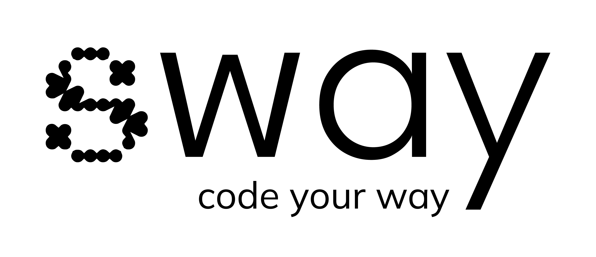

<h1 align="center">

</h1>

  <strong>Sway est un studio de développement web, mobile et IA basé près de Lyon.</strong> 
  On fabrique des sites, des applis et des outils sur mesure, qui sortent vite et qui tiennent dans le temps.

## Qui on est

Sway, c'est d'abord Louise, la fondatrice. Développeuse web de formation, curieuse de tout, elle pilote chaque projet et s'entoure de créatifs et de créatives selon les besoins.

Un site vitrine, une application mobile, un outil interne ou un peu d'IA pour gagner du temps au quotidien : on aime les projets concrets, qui servent vraiment.

Pour voir ce qu'on fait et ce qu'on a déjà livré, passez sur [le site du studio Sway](https://swayagency.fr).

### L'équipe

<table>
  <tr>
    <td align="center" valign="top" width="25%">
       
      <strong>Louise Pieri</strong> 
      Fondatrice et développeuse 
      <a href="https://www.linkedin.com/in/lpieri/">LinkedIn</a> | <a href="https://github.com/lpieri">GitHub</a> | <a href="https://www.instagram.com/louisep_off">Instagram</a>
    </td>
    <td align="center" valign="top" width="25%">
       
      <strong>Olivia Mbechezi</strong> 
      Business developer 
      <a href="https://www.linkedin.com/in/olivia-zamzam-m-14a536162/">LinkedIn</a>
    </td>
    <td align="center" valign="top" width="25%">
       
      <strong>Thomas Marchal</strong> 
      Designer UX / UI
    </td>
    <td align="center" valign="top" width="25%">
       
      <strong>Cyrielle Garcia</strong> 
      Branding et communication 
      <a href="https://www.linkedin.com/in/cyrielle-garcia-956466184">LinkedIn</a>
    </td>
  </tr>
</table>

## Notre stack

Côté back, on écrit surtout du **Go** : c'est rapide, solide et simple à maintenir. Pour le front, on part sur **React**, et sur **React Native** quand il faut une appli mobile iOS et Android sans écrire deux fois le même code. On utilise **Python** pour la data, les scripts et tout ce qui touche à l'**IA** : agents, automatisations, LLM branchés sur vos outils métier. On choisit toujours l'outil qui colle au projet, pas l'inverse.

## Nos produits

En plus des projets clients, on développe nos propres produits.

- **[Sway One](https://swone.fr)**, le logiciel de gestion de stock et d'achats par IA. Il repère pour vous les bons moments pour acheter et pour vendre, en fonction de votre stock, de vos fournisseurs et des périodes qui comptent dans votre activité.
- **[Art&Co](https://artnco.io)**, la marketplace des artisans. Vous achetez directement auprès de celles et ceux qui fabriquent, des pièces uniques et Made in France, sans intermédiaire.

## Open source

Quelques outils qu'on utilise nous-mêmes et qu'on partage volontiers.

- **[tv-home](https://github.com/sway-agency/tv)**, un launcher open source pour Android TV et Google TV. Un écran d'accueil simple, sans pub, qui retire en une commande les applis préinstallées dont vous ne voulez pas (c'est réversible et ça ne demande pas de root). Bonus : un écran de veille feu de cheminée. Vous pouvez même confier l'installation à une IA via ADB.
- **[vps-configurator](https://github.com/sway-agency/vps-configurator)**, ce qu'on utilise pour préparer et sécuriser nos serveurs Debian et Ubuntu avec Terraform et Ansible. Firewall, SSH durci, honeypot, Docker et Traefik, plus la base de données managée chez Scaleway et le DNS et le stockage chez Cloudflare.

## On en parle ?

Vous avez un projet en tête, ou juste une idée à creuser ? [Prenez rendez-vous avec Louise](https://cal.com/lpieri/rdv-avec-louise), c'est gratuit et sans engagement.
